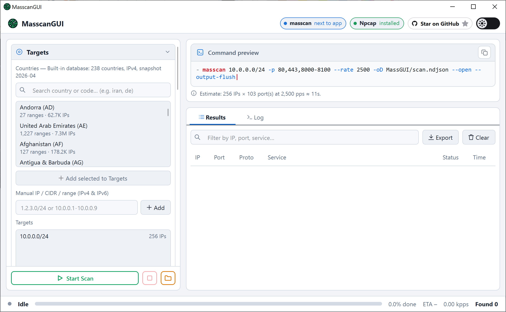
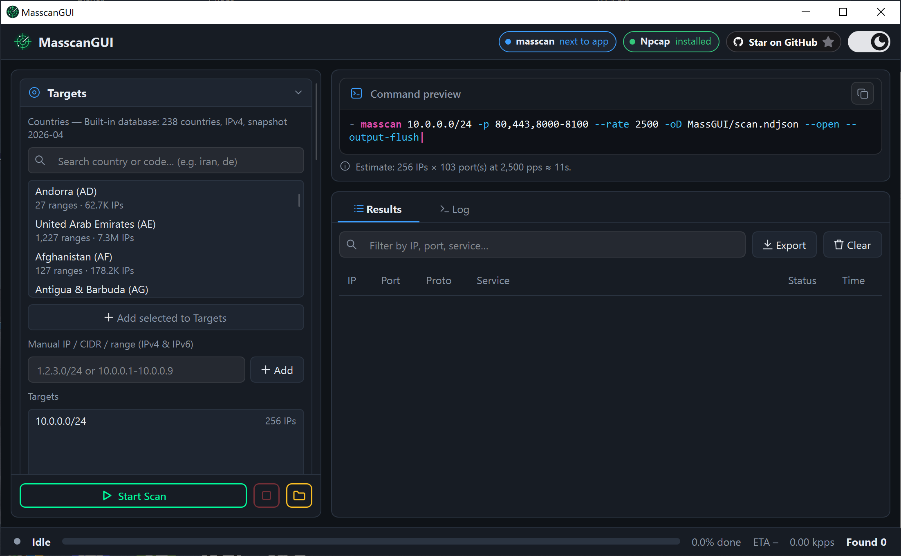

# MasscanGUI

A modern, native C++ / Qt 6 graphical interface for [masscan](https://github.com/robertdavidgraham/masscan), the Internet-scale port scanner.

Configure scans, follow progress live, and browse results in a clean desktop app—without touching the command line.

<p align="center">
  
  
</p>

## Features

- **Simple scan setup** – Enter targets and ports in a structured form instead of writing complex `masscan` flags by hand, with a live CLI command preview.
- **Country targeting** – Pick entire countries from the built-in offline GeoIP database (`data/geo.bin`) and scan their CIDR ranges in one click.
- **Live progress & controls** – Real-time scan rate (kpps), completion percentage, ETA, and open port counter, with full **Start, Pause, Resume (`paused.conf`), and Stop** support.
- **Readable results** – Open ports stream into a sortable table with automatic service detection (HTTP, HTTPS, SSH, FTP, DNS, MySQL, RDP, Redis, PostgreSQL, MongoDB, and more).
- **Multiple output formats** – Supports standard output, list (`-oL`), NDJSON (`-oD`), and JSON (`-oJ`), plus quick result export and clipboard copy.
- **Handles large scans** – Duplicate SYN-ACK responses are filtered out and the results table is capped, keeping the UI responsive during high-rate scans.
- **Automatic masscan setup** – If `masscan.exe` is not found next to the app, MasscanGUI asks for your consent and automatically downloads the latest Windows binary from [ramin-mahmoodi/Masscan](https://github.com/ramin-mahmoodi/Masscan/releases).
- **Dependency status** – Interactive header badges show whether `masscan` and `Npcap`/`WinPcap` are installed and ready.
- **Light & dark themes** – Switch seamlessly with a smooth animated transition.
- **Adaptive window layout** – Two-column workspace on wide screens, collapsing into a compact slide-over drawer on smaller windows.
- **Standalone single executable** – Distributed as a statically linked `MasscanGUI.exe` with zero external DLL dependencies.

## Quick Start

1. Install [Npcap](https://npcap.com/) (enable **"Install Npcap in WinPcap API-compatible Mode"** during setup).
2. Download the latest archive from [Releases](https://github.com/ramin-mahmoodi/MasscanGUI/releases/latest) and extract `MasscanGUI.exe` alongside the `data/` folder.
3. Launch `MasscanGUI.exe` (place `masscan.exe` beside it, or accept the automatic download prompt).
4. Enter target IPs/CIDRs and ports—or select countries from the GeoIP picker—and click **Start Scan**.

> **Note:** Only scan networks you own or have explicit permission to test.

## Building from Source

**Requirements:**
- C++20 compiler (MSVC 2022, MinGW-w64 GCC 11+, or Clang 13+)
- CMake 3.21+
- Qt 6.5+ (`Core`, `Gui`, `Widgets`, `Network`, `Svg`)

```bash
git clone https://github.com/ramin-mahmoodi/MasscanGUI.git
cd MasscanGUI
cmake -B build -S . -DCMAKE_BUILD_TYPE=Release
cmake --build build --config Release
```

## License

Released under the [GNU Affero General Public License v3.0](LICENSE).  
`masscan` is developed by [Robert David Graham](https://github.com/robertdavidgraham/masscan).
